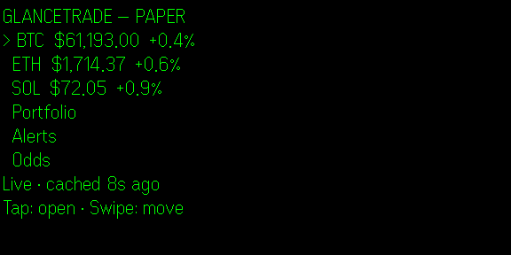
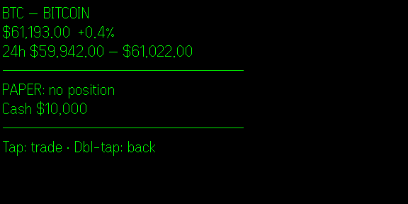
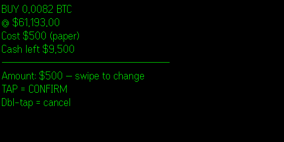
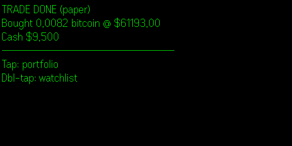
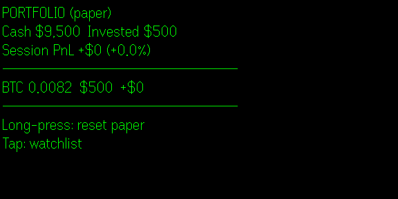
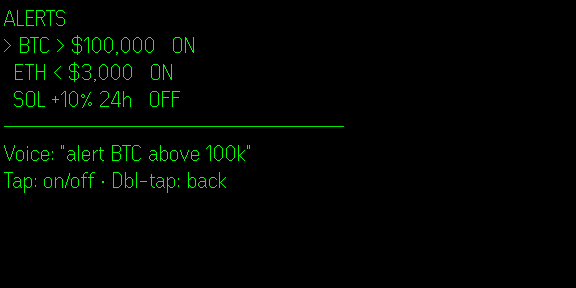
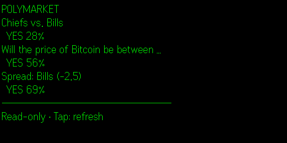
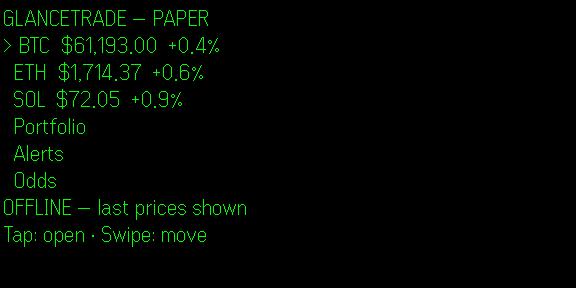
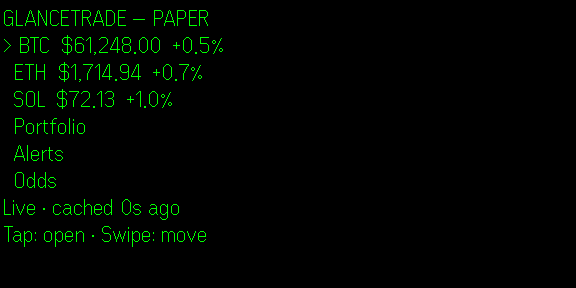

# GlanceTrade — Paper Trading on Even Realities G2

> **Heads Up: Even Realities Hackathon** · Track 02 · Crypto & DeFi
> Glance at the price. Trade by voice. Confirm with one tap. **No real money, ever.**

GlanceTrade is a web app (Vite + TypeScript) that runs in a WebView inside the
Even Realities app and renders on **Even Realities G2** smart glasses
(576 × 288 monochrome green display). It turns the glasses into a
**paper-trading terminal**: live crypto prices, a virtual $10,000 portfolio,
voice orders with one-tap confirmation, price alerts, and a read-only glance
at Polymarket odds — all while you walk, without taking your phone out.

## Status

✅ **Built during build week (23–29 Nov 2026).** All application code was
written during build week, per the hackathon rules — see the rule
disclosure below. The app is complete and simulator-verified:

- 6 screens (watchlist → asset → trade confirm → portfolio → alerts →
  Polymarket odds), paper engine ($10,000 virtual), deterministic voice
  command parser, Groq Whisper STT, optional Telegram relay (disabled by
  default), headless simulator smoke tests.
- **Verified 27 Nov 2026 in the Even Hub simulator (headless, Xvfb):**
  live prices on the watchlist (BTC $61,193, ETH $1,714, SOL $72),
  tap trade confirmed on-chain of the ledger (bought 0.0082 BTC @
  $61,193, cash $10,000 → $9,500), portfolio/PnL correct, offline
  backend shows a one-line `OFFLINE — last prices shown` (no blank
  screen), recovery re-fetches live prices, double-tap exits via the
  system dialog. Screenshots: [`docs/screenshots/`](docs/screenshots/).
- **Tests:** app unit tests 19/19 (`cd app && npm test`); server relay
  unit tests 5/5 + endpoint smoke test (`cd server && node
  test/relay.test.mjs && node test/smoke.mjs`); `evenhub pack` produces
  a 45,825-byte `.ehpk`.
- **Backend:** runs locally on `:3001`; the Vercel serverless port
  (`server/api/*.js`) is ready — deploy with root directory `server`
  (see Setup). Voice STT needs a Groq key (free tier); without it the
  app falls back to tap + typed commands.

### What existed before 23 Nov 2026 (rule disclosure)

As required by the rules, this is everything that existed before build week:

- This README, the design doc, the build plan, the SDK research notes, the
  API notes, the submission draft, and the video script (all in `docs/`).
- The repository skeleton itself (`.gitignore`, `LICENSE`, placeholder
  READMEs in `app/` and `server/`).
- **No application code.** No `package.json`, no `src/`, no `app.json`
  manifest, no backend code. The app is scaffolded from the official
  MIT-licensed `even-realities/evenhub-templates` (`asr` template) on
  23 Nov, and every line of GlanceTrade code is written during build week.
- Open-source libraries used during build week (Even Hub SDK, Vite,
  the official template) are listed in `docs/BUILD_PLAN.md`.

## Screenshots (Even Hub simulator, 576×288)

| Watchlist (live prices) | Asset | Trade confirm |
|---|---|---|
|  |  |  |

| Trade done | Portfolio | Alerts |
|---|---|---|
|  |  |  |

| Polymarket odds | Backend offline | Recovered |
|---|---|---|
|  |  |  |

(The `_view` images are the simulator's raw RGBA framebuffer composited
over black so the green-on-black display reads in a browser; the raw
captures sit next to them. The exit-dialog shot is blank by design: after
double-tap the system dialog takes over and the app container is gone.)

## The problem

Crypto moves while you are away from your desk. Checking prices means
pulling out your phone, unlocking it, opening an app, and losing the moment
you were in. Placing a trade takes even longer. Paper-trading apps exist,
but none of them are built for a **glance**: one thing on screen, a few
words, one action.

## How it works

| Moment | On the glasses |
|---|---|
| **Glance** | Watchlist: BTC / ETH / SOL with live price + 24h change. One asset in focus, swipe to move. |
| **Ask** | *"How much is Solana?"* — voice in, answer on the lens in seconds. |
| **Trade (paper)** | *"Buy 0.01 bitcoin"* → confirm screen shows price, size, and virtual cost → **one tap to confirm**. Fills at the live CoinGecko price against a virtual $10,000 portfolio stored on the phone. |
| **Track** | Portfolio screen: cash, holdings, session PnL. |
| **Alert** | *"Alert me if BTC goes above $100k"* — alert fires on the lens; optionally also via your own Telegram bot. |
| **Odds** | Top Polymarket markets, read-only, one line each. |

Full screen-by-screen design: [`docs/DESIGN.md`](docs/DESIGN.md).

## Track compliance

- **Track 02 · Crypto & DeFi.** Integrations used: **CoinGecko**
  (live prices), **Polymarket** (odds, read-only). Both have open public
  APIs; no API key is shipped in the app.
- **Money safety (rule):** the demo uses **paper trading only** — virtual
  funds, local storage, no wallet connection, no custody, no real orders.
  No financial advice is given anywhere in the app. No API keys or secrets
  are committed; server-side keys live in environment variables only.
- **Telegram (optional, special-prize angle):** an opt-in, disabled-by-
  default relay that forwards *your own* price alerts to *your own*
  Telegram bot chat. It is a notification channel only — no trading
  happens on Telegram. The special prize ("Best Telegram integration") is
  explicitly open to projects from any track — verified on the official
  DoraHacks page on 27 Nov 2026 ("Open to projects from any track: the
  best use of Telegram (accounts, bots, channels or Mini Apps) on G2"),
  so the relay is rule-compliant for a Track 02 entry; the core app works
  fully without it.
- **Stretch goal (only if time permits on day 5–6):** Hyperliquid
  testnet order preview (read-only quote, no execution without explicit
  re-scope). Not promised for the submission.

## Architecture

```
G2 glasses ──BLE── Even Realities app (WebView) ──HTTPS── GlanceTrade backend
   576×288       app/ : Vite + TS + Even Hub SDK            server/ : thin proxy
   mic/touch     - glasses UI (text containers)             - /api/prices  (CoinGecko, cached 45s)
   R1 ring       - voice capture (PCM 16 kHz)               - /api/odds    (Polymarket Gamma)
                 - paper engine (local storage)             - /api/stt     (Groq Whisper, key server-side)
                 - no secrets in the app                    - /api/alerts/telegram (relay, disabled by default)
```

The backend has two entry points sharing one implementation
(`server/api/_lib.js`): a plain Node server for local dev
(`server/server.js`, `:3001`) and Vercel serverless functions
(`server/api/*.js`). The app reaches it through `VITE_BACKEND_URL`
(default `http://localhost:3001`).

- **External calls are whitelisted** in `app.json` and routed through our
  own backend (per the hackathon brief: never ship API keys inside the app).
- **Speech-to-text is bring-your-own:** the SDK hands us raw microphone
  audio; the backend transcribes it with Groq Whisper
  (`whisper-large-v3-turbo`, free tier, key server-side only). If STT is
  unavailable, the app still works fully by tap (preset amounts) — the
  demo never depends on a single fragile path. Voice was verified
  end-to-end against Groq ("Buy 0.01 Bitcoin." transcribed in 1.4 s);
  live mic input could not be tested headless (the VM has no audio
  device), so the demo drives voice shots through the typed-command
  fallback, which runs the same deterministic parser — stated honestly in
  the video.
- **No background alerts:** while the app is open it can show live data;
  when the user switches away it cannot pop up anything (platform limit).
  That is why Telegram relay exists as the out-of-app alert path.

## Setup

Prerequisites: Node.js 18+, the Even Hub CLI + simulator:

```bash
npm install -g @evenrealities/evenhub-cli @evenrealities/evenhub-simulator
```

Run the backend first (from `server/` — zero dependencies, no install
needed):

```bash
cp .env.example .env   # paste GROQ_API_KEY for voice (free Groq key);
                       # leave it empty to run with the STT stub (503)
node server.js         # or: npm run dev (watch mode) — listens on :3001
```

Run the app (from `app/`):

```bash
npm install
npm run dev          # Terminal 1 — Vite dev server on :5173
npm run simulate     # Terminal 2 — G2 simulator (or: evenhub-simulator http://localhost:5173)
```

Point the app at a deployed backend by building with
`VITE_BACKEND_URL=https://<your-backend>` — and add that origin to the
`network` whitelist in `app/app.json` (the default build points at
`http://localhost:3001`).

Deploy the backend to Vercel (free tier; the functions live in
`server/api/`):

1. Import `github.com/darendrarp/glance-trade-g2` in the Vercel
   dashboard, root directory `server`.
2. Set environment variables: `GROQ_API_KEY` (voice; optional),
   `TELEGRAM_BOT_TOKEN` + `TELEGRAM_CHAT_ID` (relay; optional),
   `UPSTREAM_TIMEOUT_MS=9000` and `STT_TIMEOUT_MS=9000` (Vercel Hobby
   functions die at 10 s).
3. Deploy; verify `GET https://<deployment>/api/health` returns
   `{ "ok": true, ... }`.

Run the tests:

```bash
cd app && npm test        # 19/19 unit tests (parser + paper engine)
cd server && node test/relay.test.mjs   # 5/5 relay unit tests (fetch stubbed, no network)
cd server && node test/smoke.mjs       # live endpoint smoke test (prices, odds, 503 stubs)
bash sim-check.sh         # headless simulator flow + screenshots (needs the stack running)
```

Package for distribution:

```bash
cd app && npm run pack   # vite build + evenhub pack app.json dist → out.ehpk
```

Verified toolchain (27 Nov 2026): SDK `@evenrealities/even_hub_sdk`
`0.0.16`, CLI `0.2.0`, simulator `0.9.5`. Full environment notes,
including the headless-Linux simulator setup, are in
[`docs/SDK_NOTES.md`](docs/SDK_NOTES.md).

## Demo video

≤ 3 minutes, recorded in the Even Hub simulator. Script + shot list:
[`docs/VIDEO_SCRIPT.md`](docs/VIDEO_SCRIPT.md). (Recorded during build
week; this file is updated with the video link before submission.)

One honest limitation, stated in the video: live mic input could not be
tested headless (the VM has no audio device), so the voice shots drive
the typed-command fallback, which runs the same deterministic parser as
voice — the STT path itself was verified separately against Groq Whisper.

## Submission

- Hackathon: [Heads Up: Even Realities Hackathon](https://dorahacks.io/hackathon/even-realities/detail)
- Build week: 23–29 Nov 2026 · Submission deadline: **29 Nov 2026, 23:59
  Dubai time (30 Nov 2026, 02:59 WIB)**
- Demo Day: 3 Dec 2026, Daos Hub Dubai (finalists may demo remotely)
- Submission draft: [`docs/SUBMISSION_DRAFT.md`](docs/SUBMISSION_DRAFT.md)

## License

MIT. The official Even Hub templates this project is scaffolded from are
also MIT-licensed (© Even Realities).
